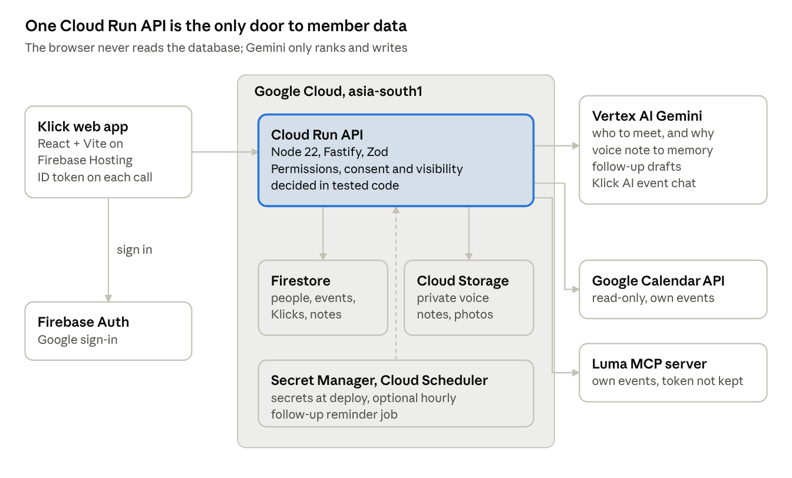

# Klick

Klick helps people meet the right people at events they're already going to, remember who they met, and follow up afterwards.

Members connect Google Calendar and Luma, see which of their Klicks are going, get Gemini suggestions for who to meet and why, exchange contact details by QR only when both people accept, keep private memories, and get a nudge to reconnect. Built for the AI Builder Cup 2026 (Sustainability & Social Impact).

| | |
|---|---|
| Live app | https://hey-os-511517.web.app (sign in with Google, then choose **Demo events**) |
| API health | https://event-networking-api-smqzajwk5q-el.a.run.app/health |
| Step-by-step guide to every feature | [`docs/GUIDE.md`](docs/GUIDE.md) |
| Architecture, data model, privacy rules, AI design | [`docs/ARCHITECTURE.md`](docs/ARCHITECTURE.md) |
| How suggestions are ranked | [`docs/RECOMMENDATIONS.md`](docs/RECOMMENDATIONS.md) |
| Roadmap and next integrations | [`docs/ROADMAP.md`](docs/ROADMAP.md) |

The Google Cloud project keeps its original id (`hey-os-511517`), so that appears in the app's URL and config.

## Architecture



The browser talks only to the Cloud Run API, sending a Firebase ID token with every request. Firestore rules deny all direct client access. Every permission, visibility and consent rule is deterministic code in `backend/src/domain` and `backend/src/db/repos`, covered by tests. Gemini only ranks and writes; it never decides who can see what.

## How Klick uses Firebase, Firestore, Cloud Run and Gemini

### Firebase

- **Hosting** serves the React 19 + Vite web app (`web/`, built to `web/dist`, deployed with `firebase deploy --only hosting`). Single-page rewrites are in `firebase.json`.
- **Authentication** handles Google sign-in in the browser (`web/src/lib/firebase.ts`). The API verifies the ID token on every request with the Firebase Admin SDK (`backend/src/lib/auth.ts`) and uses the uid as the member id. The Calendar scope (`calendar.events.readonly`) is asked for only when the member connects Calendar, and its access token is used once and never stored.

### Firestore (Native mode, asia-south1)

- **What it holds.** Members, events, event memberships, Klicks (`connections`), memories, follow-ups, QR tokens, saves, Klick AI chats, direct-message threads and more. They are defined once in `backend/src/db/schema.ts` as Zod schemas.
- **Validated writes.** Every write is validated against its schema before it is stored. Accepting, declining, revoking and blocking a Klick run in transactions, so consent changes can't race.
- **One record per real event.** An event is identified by the provider's id (Calendar `iCalUID`, Luma event id) or a shared lu.ma link, deduplicated through `eventSourceRefs`.
- **Indexes and rules.** Composite indexes and a 768-dimension vector index on `members.embedding` are in `backend/firestore.indexes.json`. `backend/firestore.rules` denies all client reads and writes.

### Cloud Run

- **The API.** One service, `event-networking-api`: Node 22, Fastify 5 and Zod, deployed from source by `infra/gcp-setup.sh`. It runs with 1 vCPU, 512 MiB, up to 3 instances, and scales to zero. It runs as its own least-privilege service account, with no key files.
- **Enforced in code.** Everything the product promises is enforced here: no guest-list endpoint, member counts floored at "fewer than 3", reciprocal visibility for suggestions, contact details only after both people accept, "attended" only from a provider check-in, and owner-only memories and chats.
- **Uploads.** It signs short-lived Cloud Storage upload URLs for voice notes, which go to a private bucket under `members/{uid}/`.
- **Secrets and jobs.** Secrets come from Secret Manager at deploy time. An optional Cloud Scheduler job calls `POST /jobs/reconnect` hourly to raise follow-up reminders.
- **Logs.** Each Gemini call writes one structured `gemini_call` log line with task, model, prompt version, attempt, latency and outcome, never content.

### Gemini on Vertex AI

Klick calls a Gemini Flash model on the global Vertex AI endpoint through the Google Gen AI SDK (`@google/genai`), configured by `GEMINI_MODEL`. Shared mechanics live in `backend/src/ai/client.ts`:
- The Zod schema is sent as `responseJsonSchema`, and the result is re-validated with Zod, with one retry. Temperature is 0.3.
- Untrusted text goes in labelled data blocks, with a rule to never follow instructions inside them.

| Task | Input | Output | Guardrails | If Gemini fails |
|---|---|---|---|---|
| Who to meet (`match.rank`) | Your profile and goal, plus up to 20 eligible candidates who chose to be findable | Up to 5 people, each with a reason, evidence pairs and a conversation starter | Candidates filtered by code before the call; invented ids dropped; evidence kept only if both phrases appear in the supplied facts | Deterministic overlap ranking, marked as not AI |
| Voice or text note to memory (`memory.extract`) | Text, or audio straight from Cloud Storage (`gs://`) | Transcript, summary, topics, promises, follow-up reason and days | Owner only; saved as a draft until the member reviews it | Retryable error; memory unchanged |
| Follow-up draft (`reconnect.draft`) | Follow-up reason and the owner's own memories | Why now, plus a draft message | Only the owner's memories; Klick must still be accepted; never sent automatically | Follow-up stays open with a retry |
| Klick AI event chat (`chat.answer`) | Question, last 10 turns, and permission-checked context (your Klicks going, findable people, Discover events) | Text, people, events, sources, suggestions | Ids outside the supplied lists dropped; people re-checked on every read; never sees contact details | Error shown with retry; nothing saved |

## Quality and performance

Measured 17 Oct 2026:

| What | Result |
|---|---|
| Automated tests (Vitest on the Firestore emulator, run in CI on every pull request) | 50 of 50 pass |
| Lighthouse, welcome screen, mobile, simulated slow 4G | Accessibility 100, Performance 81, Best practices 96; largest paint 3.7 s |
| Web app download | 220 KB JavaScript gzipped; the 3D QR (136 KB) loads only when shown |
| Gemini, who to meet (46 live calls) | Median 10.8 s |
| Gemini, voice note to memory (3 live calls) | Median 5.5 s |

## Layout

```
backend/                 Node 22 + TypeScript + Fastify, deployed to Cloud Run
  src/db/schema.ts       Zod schemas for every collection (single source of truth)
  src/db/repos/          Firestore reads and writes per collection
  src/ai/                Gemini tasks: match ranking, memory extraction, reconnection drafts, Klick AI chat
  src/services/          Permission checks before any data reaches Gemini; Discover, chats, demo data
  src/domain/            Pure rules: membership states and safe wording, the connection consent state machine
  src/lib/lumaMcp.ts     Luma connector over Luma's official MCP server (OAuth + PKCE, own events only)
  src/lib/mockLuma.ts    Luma-shaped sample events, for trying Klick without a Luma account
  src/server.ts          REST API (/v1/...)
  firestore.rules        Clients get no direct access; everything goes through the API
  scripts/seed.ts        Sample members on the sample events
  test/                  Unit tests and API tests against the Firestore emulator
web/                     React + TypeScript + Vite, deployed to Firebase Hosting
design/                  The Prod :D design system the web app is built from
infra/gcp-setup.sh       One-time Google Cloud setup and deploy
docs/                    Architecture, recommendations, step-by-step guide, roadmap
.github/                 CI (backend tests on the Firestore emulator, web lint and build) and PR template
```

## Try it

Sign in with Google at https://hey-os-511517.web.app and finish onboarding. To see every feature with data in it, choose **Demo events** in the "Where do your events live?" onboarding step (or later from Profile, Connected accounts). It adds two sample events, three Klicks you met at a past meetup, one pending request, a private note with a follow-up, and a few messages. Sample people are clearly fictional and use `example.com` addresses.

For a walkthrough of every feature, including the QR exchange with a second account, see [`docs/GUIDE.md`](docs/GUIDE.md).

## Run locally

Needs Node 20+ and Java 11+ (for the Firestore emulator).

```bash
cd backend
npm install
npm test                       # starts the emulator and runs the tests
npm run emulators              # terminal 1: emulator on 127.0.0.1:8081
cp .env.example .env           # terminal 2:
export $(cat .env | xargs)
npm run seed
npm run dev                    # API on http://localhost:8080
curl -H 'x-dev-member: demo-meera' localhost:8080/v1/events
```

`AUTH_MODE=dev` lets the `x-dev-member` header stand in for a Firebase login. Never set it in Cloud Run.

Web app:

```bash
cd web
cp .env.example .env.local     # fill in the Firebase web config and API URL
npm install && npm run dev
```

## Deploy to Google Cloud

```bash
gcloud auth login && gcloud auth application-default login
PROJECT_ID=your-project-id ./infra/gcp-setup.sh
cd web && npm run build && cd .. && npx -y firebase-tools deploy --only hosting
```

The script creates or reuses the project, checks billing, enables APIs, creates Firestore (asia-south1), a private media bucket, a least-privilege service account and its secrets, adds Firebase, deploys rules and indexes, deploys the API to Cloud Run and, with `SCHEDULER=1`, schedules the hourly reconnection job. Set a budget alert by hand.

## Rules the code enforces

- Klick imports only your own events and never stores guest lists. Event pages show counts, floored at "fewer than 3", your own Klicks who are going, and, only if you are findable for that event, others who chose to be found.
- "Attended" comes only from a provider check-in record; anything else shows as "Planning to attend". Attendance is never inferred.
- Suggestions only include members who chose to be findable at that event, and only if you are findable too.
- A Klick needs the other person to accept; either side can end it or block. Contact details are shown only after both accept, and only the fields each person chose.
- Memories are private to their owner. Klick AI chats are private to their owner.
- Follow-ups and messages are never sent for you.
- Disconnecting a source (API only for now) deletes every event membership it created.

## API (all under `/v1`, Bearer Firebase ID token)

| Area | Endpoints |
|---|---|
| Profile and onboarding | `GET/PUT /me` · `GET /members/:id` · `PUT /onboarding/step` · `/onboarding/linkedin/*` · `POST /onboarding/identity/skip` · `POST /onboarding/integrations/done` · `PUT /onboarding/questionnaire` |
| Sources | `GET /sources` · `GET /sources/luma_mcp/start` · `POST /sources/luma_mcp/callback` · `POST /sources/google_calendar/sync` · `POST /sources/mock_luma/connect` · `DELETE /sources/:provider` |
| Events | `GET /events` · `GET /events/:id` · `PUT /events/:id/{goal,visibility,attendance}` · `GET /events/:id/matches` (Gemini) · `PUT/DELETE /events/:id/save` · `PUT/DELETE /events/:id/saves/:memberId` |
| Discover | `GET /discover` · `GET /discover/:id` · `POST /events/:id/plan` |
| Klicks | `POST /qr` · `GET /qr/:token` · `POST /connections` · `GET /connections` · `GET /connections/:id` · `PUT /connections/:id/shared-fields` · `POST /connections/:id/{accept,decline,revoke,block}` |
| Memories and follow-ups | `POST /uploads` · `POST/GET /memories` · `POST /memories/:id/{analyze,review,share}` · `DELETE /memories/:id` · `POST/GET /followups` · `POST /followups/:id/draft` (Gemini) · `POST /followups/:id/{sent,done,dismissed}` |
| Chats | `GET /chats` · `GET/POST /events/:id/ai-chats` · `GET/DELETE /ai-chats/:id` · `POST /ai-chats/:id/messages` (Gemini) · `GET/POST /dm/:connectionId` |

Outside `/v1`: `GET /health`, `GET /oauth/luma-client.json` (Luma's client id document) and `POST /jobs/reconnect` (scheduler, secret header).

## Trying the real Luma connection

Luma signs apps in with a public "client id" URL, so the API must be reachable on the internet first (deploy with `infra/gcp-setup.sh`, which sets `PUBLIC_API_URL`). Then, from `backend/`:

```bash
LUMA_CLIENT_ID=https://<your-cloud-run-url>/oauth/luma-client.json npm run luma:inspect
```

It opens Luma's sign-in, lists the tools Luma offers, and prints your own events as Klick would import them. Nothing is saved.

## Team and tools

Built by Diya and Sivasurya. Parts of the code and docs were written with AI assistance (Claude), reviewed and directed by the team; commits credit it as co-author.
